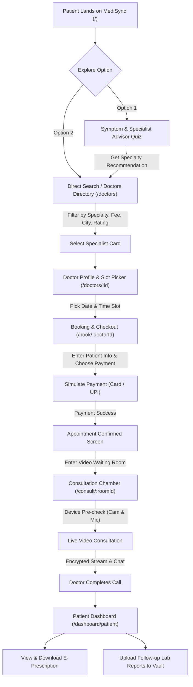
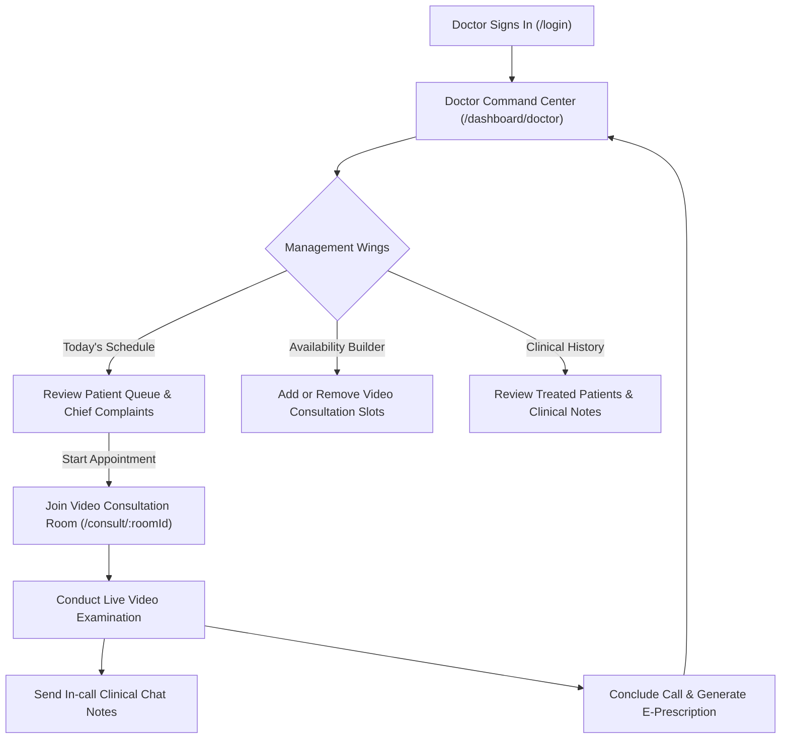
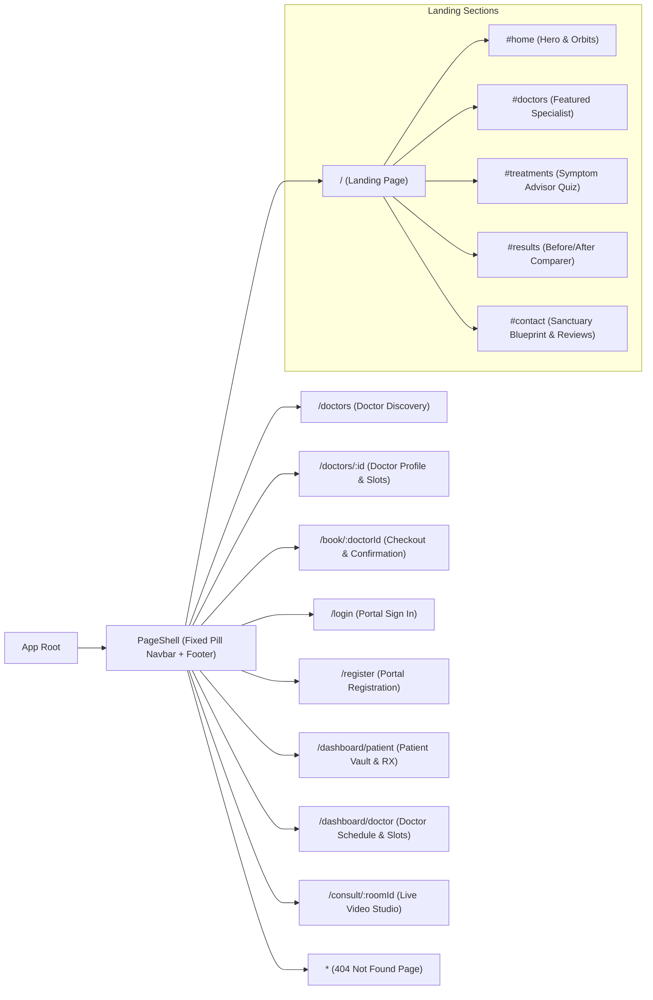
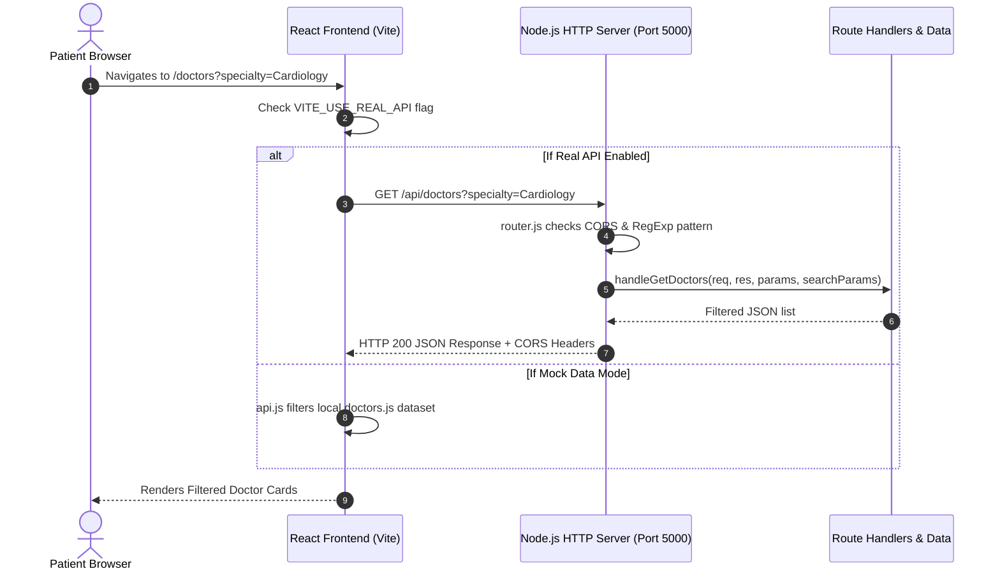
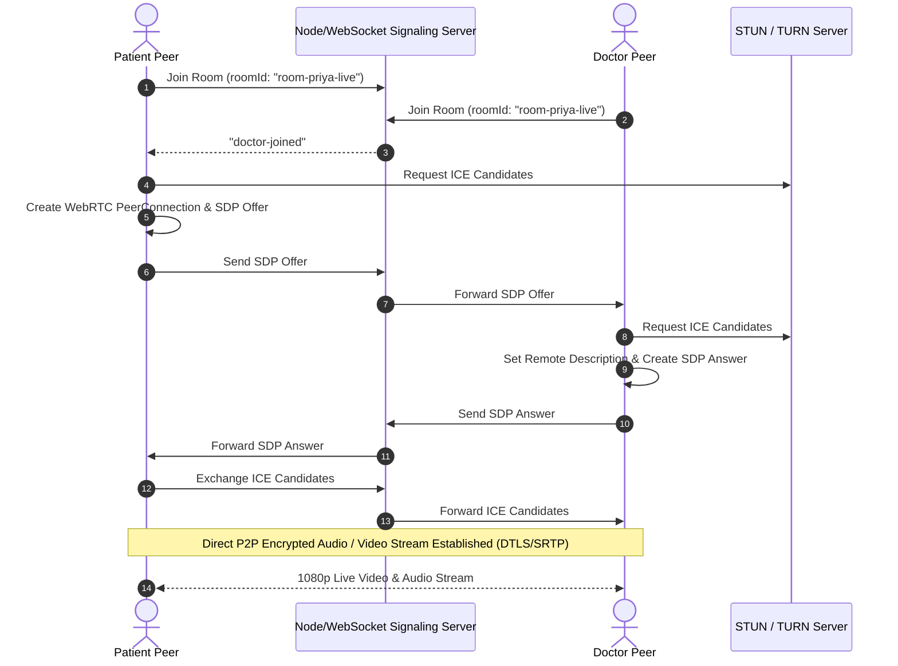
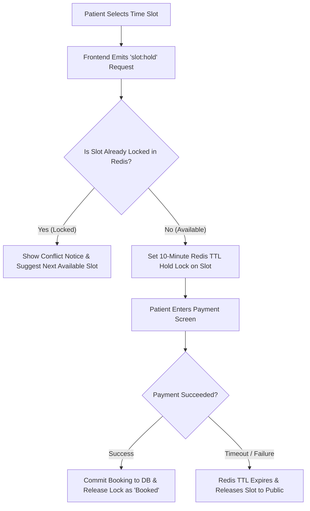

# MediSync — System Architecture & User Flows

This document details the user journeys, routing topology, request flows, and WebRTC signaling flows for the MediSync telemedicine platform using Mermaid diagrams.

---

## 1. Patient Journey (Search to Prescription)

The primary patient flow takes a user from initial symptom exploration or doctor search through slot booking, simulated payment, virtual consultation, and medical record/prescription delivery.

---

## 2. Doctor Journey (Workspace & Practice Management)

The clinician journey allows doctors to manage their daily patient appointments, set online availability slots, and review clinical histories.

---

## 3. Frontend Route Map

The hierarchical route structure of the React application managed by React Router v6.

---

## 4. Request Flow (Frontend to Node.js Backend)

The interaction between the React client and the standalone native Node.js HTTP service.

---

## 5. Planned Future WebRTC & Signaling Architecture

The planned peer-to-peer WebRTC consultation architecture for production deployment.

---

## 6. Planned Distributed Slot Booking Flow

To prevent double booking across simultaneous telemedicine requests:

